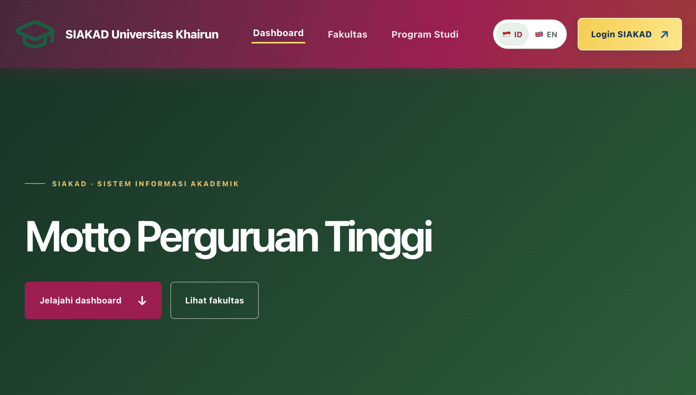
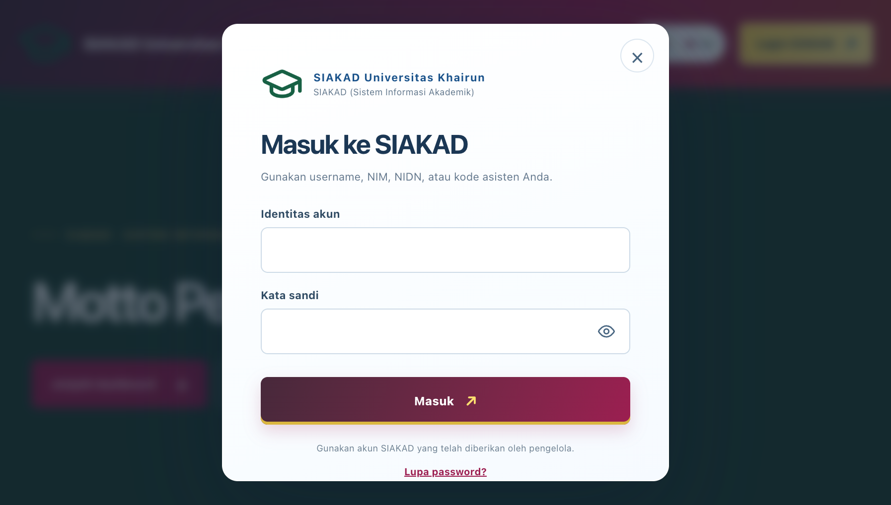

# SIAKAD

**SIAKAD (Sistem Informasi Akademik)** is a role-based web application for
university academic, student, financial, graduation, and administrative
workflows. It is built with Laravel and is designed to be configured for a
university's own database and institutional identity.

> **Important:** this repository contains application code and a clean-install
> database schema, not a populated university database. It has no demo student
> records or shared demo login. A new local installation starts with empty
> application tables; create the first administrator with the secure setup
> command described below.

## Preview

The screenshots show the public landing page and login dialog. They are
captured from the application with live hero photography removed; they do not
include live student, financial, or dashboard data.

| Landing page | Login |
|---|---|
|  |  |

## Main capabilities

- Public university, faculty, and study-program pages with academic summaries.
- Role-specific dashboards and menus for academic staff, faculty and university
  leadership, finance, students, lecturers, and other operators.
- Master data, academic calendars, class schedules, registration, KRS, grades,
  attendance, KHS, transcripts, student status, and academic transfers.
- LMS/virtual classes, short-semester workflows, E-Skripsi, E-Tesis and
  Disertasi, KKN/Kubermas, and graduation administration.
- UKT and IPI billing, Midtrans Sandbox/Production integration, manual billing,
  transaction history, and payment-status checks.
- PDDIKTI/Feeder configuration, staged initialization, exports, and scheduled
  synchronization.
- System branding, bilingual user interface (Indonesian/English), account
  administration, activity log, and notifications.
- Web Service API under `/api/v1`.

For the detailed role matrix and feature inventory, see
[Feature and role guide](docs/FITUR-DAN-ROLE.md). For setup, database, Feeder,
and daily-use instructions, see
[Local installation guide](docs/INSTALASI-LOKAL.md).

## Quick start

This project uses PHP, Composer, Node.js/npm, and a MySQL-compatible database.
Use PHP 8.4.1 or later for the local CLI; the Composer manifest declares
`^8.3`, and the current project environment was checked with PHP 8.4.12.

```bash
git clone <URL-REPOSITORY>
cd siakad
cp .env.example .env
composer install
npm ci
```

Create a **new, empty** MySQL/MariaDB database (for example `siakad`), configure
the `.env` values for both `DB_*` and `SIMAK_DB_*`, and then run:

```bash
php artisan key:generate
npm run build
php artisan migrate --database=simak_main --schema-path=database/schema/siakad_main_schema.sql
php artisan siakad:bootstrap-admin
php artisan storage:link
php artisan serve --host=127.0.0.1 --port=8000
```

The bootstrap command prompts for a private administrator password; no
`admin/admin` password is included in this repository. Open
<http://127.0.0.1:8000> after the setup command finishes. See the installation
guide for exact database settings, XAMPP/phpMyAdmin setup, Feeder stages,
resume/rerun procedures, and integrations.

## Technology

- Laravel 13 / PHP
- MySQL or MariaDB through PDO MySQL
- Vite, Tailwind CSS, and JavaScript frontend assets
- Midtrans Snap, PDDIKTI/Feeder, and SMTP integrations (optional; each requires
  the institution's own credentials)

## Security and data handling


- The SQL baseline
  [`database/schema/siakad_main_schema.sql`](database/schema/siakad_main_schema.sql)
  is only for a new empty database. It is not a database upgrade script.
- Do not run `migrate:fresh`, `migrate:refresh`, or Feeder initialization against
  a database containing data you need to keep.
- This project uses the custom license in [`LICENSE`](LICENSE). It permits free
  use and redistribution, prohibits charging for the application itself, and
  requires preserving the “Created by Salkin” attribution. It is not an
  OSI-approved open-source license.

## Contributing

Please open an issue before making large changes. Include the relevant feature,
role, expected behavior, and test coverage. Run focused tests with an isolated
test database; do not point automated tests at a university's operational
database.
